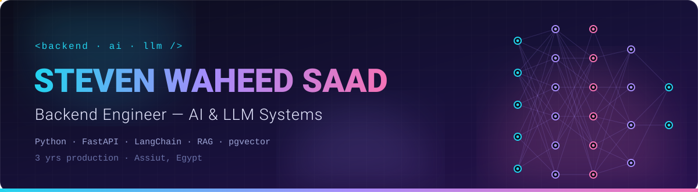
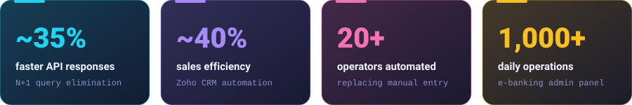
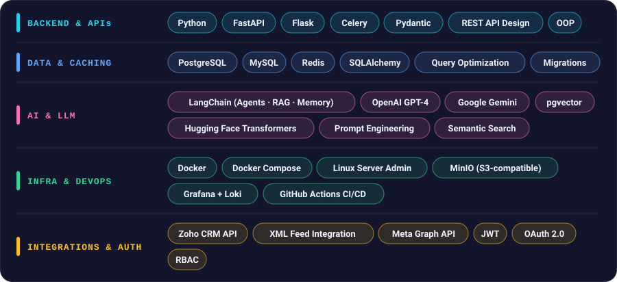
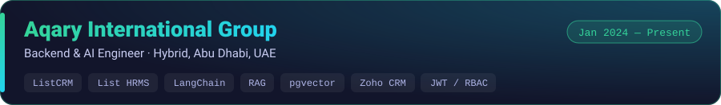
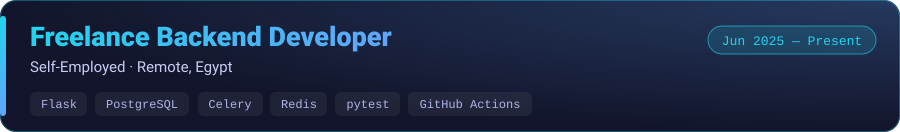
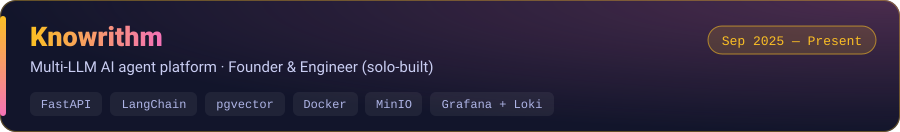
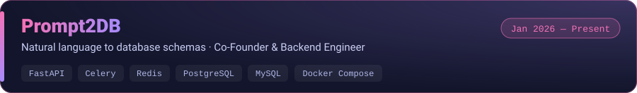
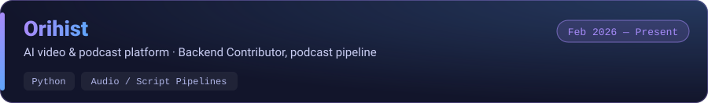
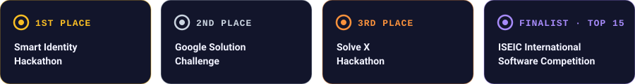

 

 

Backend engineer with **3 years** of professional experience building production Python systems (FastAPI, Flask) and shipping AI/LLM features into live products.

- At **Aqary International Group**, I contribute to two internal platforms (a CRM and an HR management system) and own the company's AI-driven lead automation: a LangChain conversational agent and a RAG pipeline on PostgreSQL / pgvector.
- I designed, built, and operate **Knowrithm**, a multi-LLM AI agent platform, end to end: backend architecture, vector search, SDKs, self-managed deployment, and observability.
- I'm comfortable owning a system from database design through to production infrastructure.

 

 

 

- Contribute to the backend team building **ListCRM** and **List HRMS**, the company's internal CRM and HR platforms: REST APIs, data models, and business logic used across sales and HR operations.
- Designed and built a **LangChain conversational agent** for WhatsApp lead handling, with tool-calling, multi-turn memory, and context-window management.
- Built a **RAG pipeline** on pgvector: chunking and embedding property documents into PostgreSQL to ground agent responses and reduce hallucinations.
- Deployed **Hugging Face Transformer** inference pipelines for sentiment analysis and multi-label classification of customer feedback and property listings.
- Optimized PostgreSQL and MySQL performance by removing N+1 query patterns (SQLAlchemy `joinedload` / `selectinload`) and refactoring queries, cutting API response times by **~35%** on high-traffic endpoints.
- Built and maintained a **Zoho CRM integration** automating lead and sales workflows for **20+ operators**, replacing manual data entry and improving reported sales-tracking efficiency by **~40%**.
- Developed **bi-directional sync pipelines** for large-scale XML/REST feeds with **Bayut** and **Property Finder**, keeping thousands of live listings in sync.
- Implemented **JWT authentication** with refresh-token rotation, **OAuth 2.0**, and **RBAC** across web, mobile, and CRM clients.

- Built a production-style **e-banking backend** (Flask + PostgreSQL) covering account transfers, transaction validation, and an admin telemetry panel processing **1,000+ operations daily**.
- Designed an **asynchronous task layer** with Celery + Redis to isolate report generation and notifications, keeping core API responses under **200 ms**.
- Built a **B2B purchase-order platform** with hierarchical approval workflows and supplier tracking, exposed through REST APIs.
- Wrote automated test suites with **pytest** and set up **GitHub Actions** CI for continuous testing and code-quality checks.

 

A platform that lets businesses connect their own **OpenAI, Anthropic, Google Gemini, or Mistral** API keys to conversational agents grounded in their own data.

- **Data & RAG layer:** document processing (PDF, CSV, DOCX), website crawling, and a PostgreSQL / pgvector semantic-search and embedding pipeline.
- **Model routing:** agents switch between LLM providers without code changes, allowing cost/performance trade-offs per request.
- **Developer tooling:** native Python and TypeScript SDKs (automatic retries, streaming responses, multipart file transfers) and an administrative CLI with agent lifecycle commands and multi-format analytics export.
- **Security & operations:** RBAC and encrypted per-tenant API-key storage. The full stack is self-hosted with Docker, MinIO (S3-compatible storage), and Grafana + Loki for centralized logging and monitoring.

**Repositories:** [Python SDK](https://github.com/Knowrithm/knowrithm-py) · [TypeScript SDK](https://github.com/Knowrithm/knowrithm-typescript-sdk) · [CLI](https://github.com/Knowrithm/knowrithm-cli) · [Docs](https://github.com/Knowrithm/knowrithm-docs)

An AI system, built with a small founding team, that converts natural-language instructions into database schemas, migrations, and parameterized mock data.

- Own the **FastAPI backend** and async processing layer, offloading schema generation and multi-table evaluation to **Celery / Redis** queues to keep API responses under **300 ms**.
- Containerized the system with **Docker Compose**, including isolated internal networks and multi-database environment bindings.

Building the backend service for Orihist, an AI video and podcast creation platform, that turns generated scripts into multi-speaker audio output.

 

**B.Sc. in Computer Science, Summa Cum Laude (GPA 3.5 / 4.0)** — Assiut University, Egypt · Graduated Jul 2023
Focus: Artificial Intelligence, Machine Learning, Advanced Algorithms, NLP. Codeforces competitor and ECPC (Egyptian Collegiate Programming Contest) participant.

**Languages:** English (Professional Proficiency) · Arabic (Native)

 

